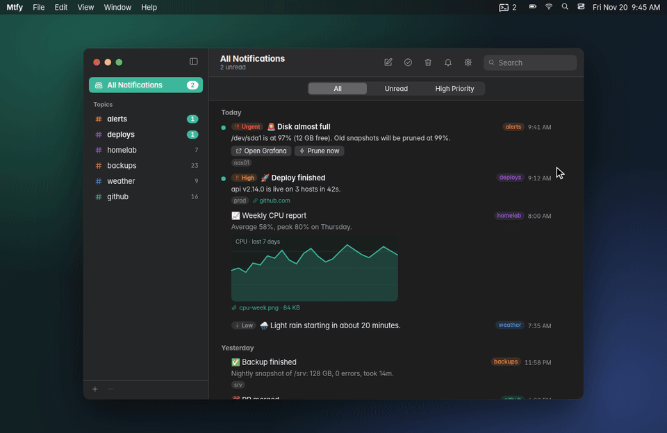
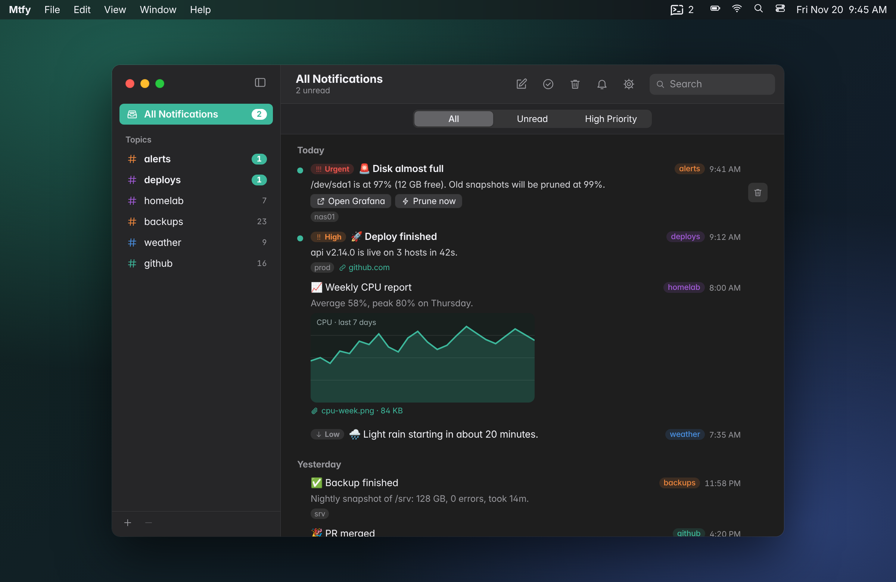
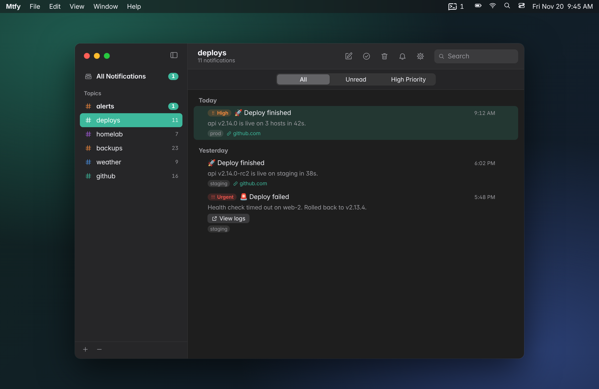
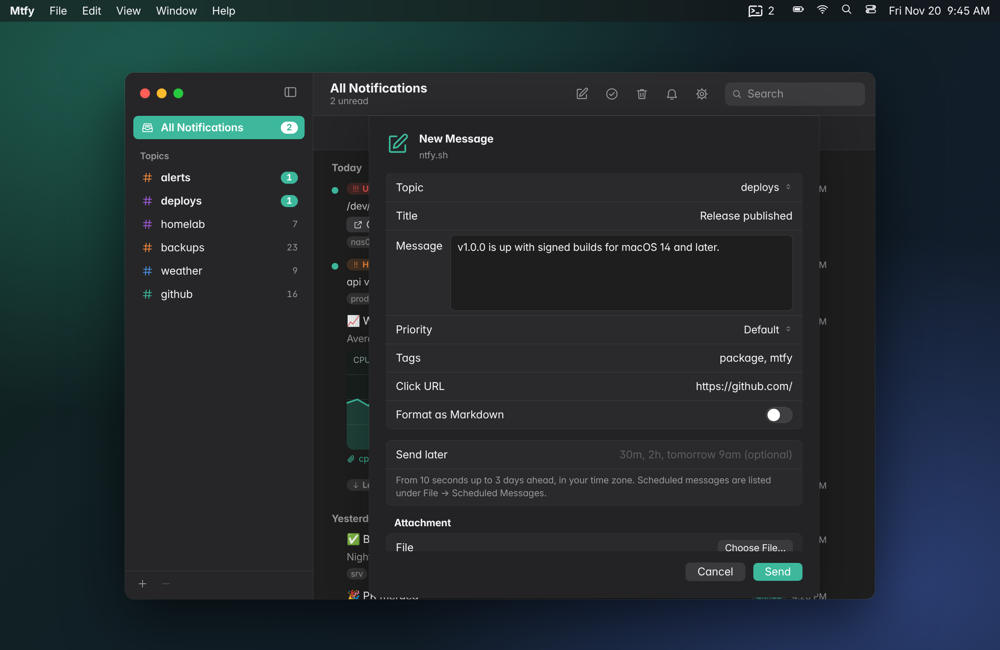
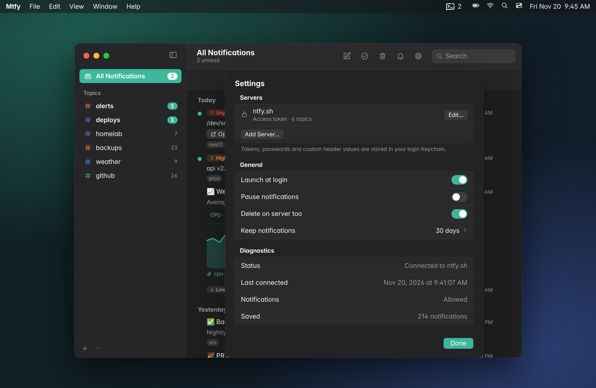
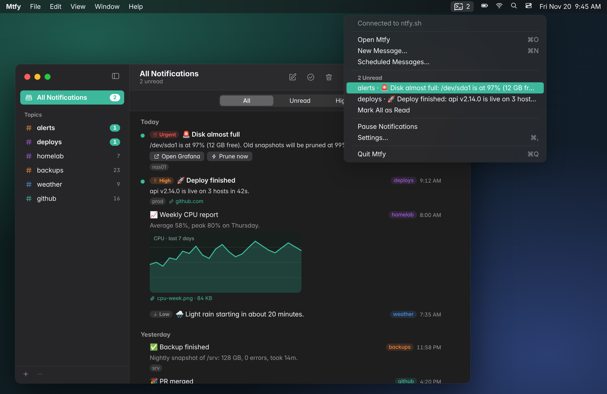
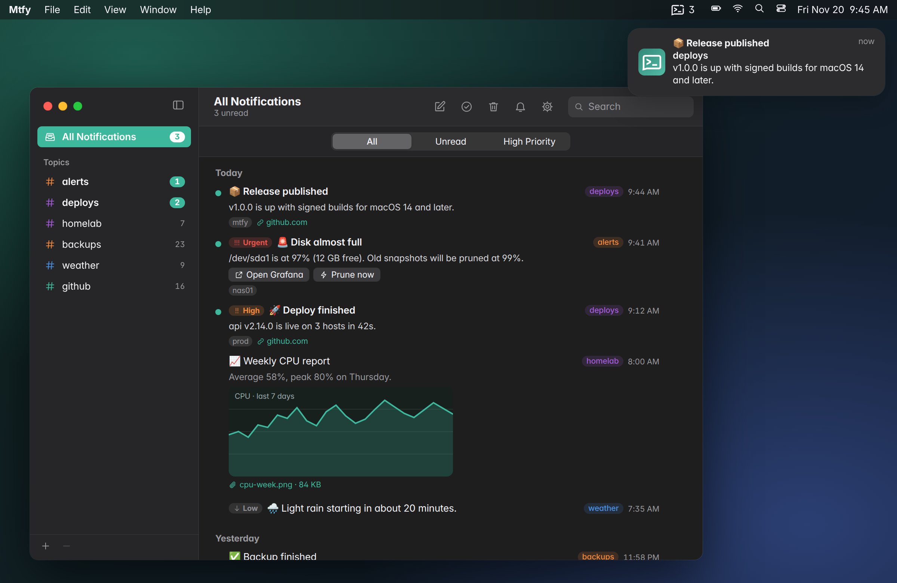

<p align="center">
  
</p>

<h1 align="center">mtfy</h1>

<p align="center">
  <b>A native macOS client for <a href="https://ntfy.sh">ntfy</a>.</b><br>
  Lives in the menu bar, shows desktop notifications, and keeps a searchable history of everything you receive.
</p>

<p align="center">
  
  
  
  
  
</p>

<p align="center">
  <a href="#install">Install</a> &nbsp;&bull;&nbsp;
  <a href="#features">Features</a> &nbsp;&bull;&nbsp;
  <a href="#command-line">Command line</a> &nbsp;&bull;&nbsp;
  <a href="#security-and-privacy">Security</a> &nbsp;&bull;&nbsp;
  <a href="https://github.com/acidvegas/mtfy">GitHub</a> &nbsp;&bull;&nbsp;
  <a href="https://git.supernets.org/acidvegas/mtfy">SuperNETs</a>
</p>

<p align="center">
  
</p>

## Overview

mtfy keeps one streaming connection to each of your ntfy servers and turns every message into a native macOS notification. Everything you receive is saved locally, grouped by day, and searchable. It runs at login, lives in the menu bar only *(no Dock icon)*, and ships with an `mtfy` command for sending and reading messages from the terminal.

Written in Swift with SwiftUI and AppKit. No third-party dependencies.

<table>
  <tr>
    <td width="50%"></td>
    <td width="50%"></td>
  </tr>
  <tr>
    <td align="center"><sub><b>All notifications</b> with priorities, actions and image attachments</sub></td>
    <td align="center"><sub><b>Per-topic view</b> with unread counts and colors</sub></td>
  </tr>
  <tr>
    <td width="50%"></td>
    <td width="50%"></td>
  </tr>
  <tr>
    <td align="center"><sub><b>Compose</b> with priority, tags, scheduling and attachments</sub></td>
    <td align="center"><sub><b>Settings</b> with servers, logins and diagnostics</sub></td>
  </tr>
  <tr>
    <td width="50%"></td>
    <td width="50%"></td>
  </tr>
  <tr>
    <td align="center"><sub><b>Menu bar</b> with the latest unread messages</sub></td>
    <td align="center"><sub><b>Native notifications</b> with Mark as Read and Delete</sub></td>
  </tr>
</table>

## Features

**Notifications**
- Native macOS notifications with **Mark as Read** and **Delete** buttons on the banner
- Priority-aware: priority 1-2 arrive quietly, 3-5 with sound
- Clicking a notification opens its click URL, or shows the message in the app
- Per-topic mute *(for 1 hour, 8 hours, a day, or until turned back on)* and minimum priority, plus a global pause
- Catches up on messages missed while asleep or offline, without duplicates

**Main window**
- Topic sidebar with unread counts, colors, and custom display names, grouped by server when you use more than one
- Messages grouped by day, with search and All / Unread / High Priority filters
- Mark read/unread, delete *(hover button, ⌫, or right-click)*, mark all read, delete all
- Deleting also deletes on the server, for everyone subscribed to the topic *(needs write access; can be turned off in Settings)*
- Deleted notifications stay deleted: they won't come back from a history reload or reconnect
- Per-topic auto-delete, overriding the global "Keep notifications" setting
- Text size: **⌘+**, **⌘−**, **⌘0**

**Sending**
- Compose messages *(**⌘N**)*: title, priority, tags, click URL, Markdown, icon, email forwarding, up to three action buttons, and a file or link as an attachment
- Schedule messages *("30m", "tomorrow 9am")*; see and cancel pending ones under **File > Scheduled Messages**
- Edit a message you sent from this Mac *(right-click > **Edit…**)*; the update replaces it for everyone

**ntfy support**
- Message updates, clears, and deletes *(`sequence_id`, `message_clear`, `message_delete`)*
- Action buttons: `view`, `http`, and `copy`, in the list and on notification banners
- Image attachment previews, file attachments, and icons
- Markdown messages: formatting, links, headings, lists, quotes, code, and images
- Emoji tags *(`warning` shows a warning sign)*, using the same shortcodes as the official clients
- Loads the server's cached history when you subscribe to a topic
- `ntfy://server/topic` links subscribe in one click *(after asking)*

**Servers**
- Several servers at once, each with its own login
- Access token or username and password
- Custom headers on every request to a server, for login proxies
- Self-signed certificates: trust a server's certificate by its fingerprint
- Plain `http://` servers, for example on your local network *(with a warning)*
- Tells you when a server runs an outdated ntfy version *(needs an admin login on that server)*

## Install

Requires macOS 14 *(Sonoma)* or later and Xcode or the Xcode Command Line Tools *(`xcode-select --install`)*.

```sh
git clone https://github.com/acidvegas/mtfy
cd mtfy
./build.sh --install
```

`./build.sh` alone builds `build/Mtfy.app`. With `--install` it moves the app to `~/Applications` *(one copy only)*, launches it, and installs the `mtfy` command in `~/.local/bin`.

The app is signed with your **Apple Development** certificate if you have one, so Keychain access survives rebuilds. Otherwise it is signed ad-hoc, and macOS asks for Keychain access again after each rebuild *(choose **Always Allow**)*. To pick a specific certificate:

```sh
SIGN_IDENTITY="Apple Development: you@example.com (TEAMID)" ./build.sh --install
```

## Setup

1. Launch the app. It adds itself to Login Items on first run.
2. Open **Settings** *(⌘,)*. `https://ntfy.sh` is set up already; click **Edit…** to change it, or **Add Server…** to add another.
3. Choose authentication: none, an **access token** *(recommended; create one under Account > Access tokens in the ntfy web app)*, or username and password. Use **Test Connection** to check it.
4. Add topics with the **+** button at the bottom of the sidebar.

Right-click a topic to mute it, set its color, or send a message to it. **Topic Settings…** also has its display name, minimum priority, and how long to keep its notifications.

**Self-signed certificates.** Test Connection shows the certificate's SHA-256 fingerprint. Check it against the one on your server and click **Trust This Certificate**. Alternatively, add your own certificate authority to the System keychain and mark it as trusted, and no setting is needed.

## Command line

`build.sh --install` adds an `mtfy` command *(a small script in `~/.local/bin` that runs the app's own program, so it uses the servers and logins saved in the app)*. It is named `mtfy` so it never gets in the way of the official `ntfy` CLI.

```sh
mtfy send alerts "Backup finished" --title Backup --tags white_check_mark
echo "disk at 91%" | mtfy send alerts --priority high
mtfy send alerts "Rotate the keys" --delay "tomorrow 9am"
mtfy send alerts "Report" --attach ~/report.pdf --action "view, Open, https://example.com"
mtfy list --unread            # or: mtfy list alerts --limit 50 --json
mtfy topics
mtfy scheduled                # then: mtfy cancel alerts <id>
mtfy status
mtfy pause / mtfy resume
mtfy read alerts              # mark read; without a topic, everything
mtfy open alerts
mtfy subscribe alerts --name "Server alerts"
mtfy unsubscribe alerts
```

Run `mtfy help` for every option. With more than one server, add `--server <host>` to topic commands. Commands that change the app *(pause, read, subscribe…)* go to the running app, which is started if needed.

## Security and privacy

| | |
|---|---|
| **HTTPS by default** | A server can use plain `http://` only if you enter it that way, and the app warns that it isn't encrypted. Everything else *(action buttons, images from other hosts)* must use https. Redirects are refused, so credentials are never forwarded to another host. |
| **Certificates** | Must be valid, unless you trust one specific self-signed certificate for a server. Only that exact certificate is accepted, and only for that server. To allow this and plain `http://`, App Transport Security is turned off in `Info.plist` and the app does these checks itself. |
| **Credentials** | Tokens, passwords and custom header values are stored in the login Keychain and are never written to preferences or logs, or shown again in the UI. |
| **Logins stay put** | Your login is only sent to the server it was saved for. Changing a server's URL requires entering the token, password, and custom header values again. |
| **Local data** | Notifications are saved to `~/Library/Application Support/local.mtfy/messages.json`, readable only by you. Optional auto-cleanup removes old ones *(Settings > Keep notifications)*. No cookies or HTTP cache are written. |
| **Links** | Only `http`, `https`, and `mailto` links are ever opened, whether they come from click URLs, Markdown, attachments, or action buttons *(`mailto` only from click URLs and Markdown)*. |
| **Deceptive links** | URLs with embedded credentials *(`https://bank.com@evil.example`)* are rejected, and a Markdown link whose text doesn't show its real host *(or email address)* gets it appended. |
| **`http` actions** | They send a request chosen by whoever published the message, so the app shows the host, method, URL, headers, and body and asks before sending. They must use https. |
| **Images** | Load only from your ntfy servers unless you allow other hosts *(Settings > Privacy)*, because loading from other hosts reveals your IP address. Downloads are capped at 10 MB and decoded as bounded-size thumbnails. |
| **Update checks** | For servers where your login is an admin account, the app asks the server for its ntfy version *(only admins may)* and, once a day, asks GitHub for the latest ntfy release. GitHub isn't contacted if no server's version is known. |
| **Untrusted input** | Optional message fields are parsed leniently, so a malformed field is dropped instead of the whole message, and values are length-limited before display. |

## Troubleshooting

Problems appear in a bar at the top of the window, with a button to fix them where possible. The menu bar icon switches to a warning symbol, and serious problems also post one desktop notification. This covers:

- notifications turned off for Mtfy in System Settings
- the server rejecting your login, or no saved login
- the connection being down for more than 2 minutes
- settings that can't be read *(they're backed up, and saved notifications are kept)*
- saved notifications that can't be read or written *(an unreadable file is moved aside, not overwritten)*
- past messages for a topic failing to load

**Settings > Diagnostics** shows the connection status, last error, and notification permission. **Copy Diagnostics** copies a summary for bug reports. It never includes tokens, passwords, topic names, or message contents.

For detailed logs:

```sh
log stream --predicate 'subsystem == "local.mtfy"' --level debug
```

<details>
<summary><b>Project layout</b></summary>

```
Sources/Mtfy/
  App.swift          App delegate: menu bar item, notifications, windows, connection lifecycle
  CLI.swift          The `mtfy` command
  Subscriber.swift   ntfy JSON message model, streaming connection, and HTTP calls
  Store.swift        Saved messages, topics, and settings shared by every view
  MainView.swift     Main window: sidebar, message list, topic colors, text scaling
  Sheets.swift       Add topic, topic settings, and compose sheets
  SettingsView.swift Server, login, and general settings
  Actions.swift      Runs action buttons (view / http / copy)
  Images.swift       Image loading with host policy and size limits
  MenuBarIcon.swift  Menu bar icon with unread, paused and problem badges
  Config.swift       Settings model and input validation
  Keychain.swift     Credential storage
  Log.swift          Logging and the problem model
  Emoji.swift        Generated tag to emoji table (do not edit by hand)
Resources/Info.plist
Resources/MenuBarIcon.svg   ntfy's outline logo, Apache License 2.0 (menu bar icon, and the app icon's artwork)
scripts/
  make-icon.swift    Renders the app icon from the ntfy logo (run by build.sh)
  gen-emoji.py       Regenerates Emoji.swift from GitHub's gemoji data
docs/                README images
build.sh             Builds, signs, and optionally installs the .app
```

To regenerate the emoji table:

```sh
curl -o emoji.json https://raw.githubusercontent.com/github/gemoji/master/db/emoji.json
python3 -I scripts/gen-emoji.py emoji.json Sources/Mtfy/Emoji.swift
rm emoji.json
```

</details>

<details>
<summary><b>Uninstall</b></summary>

1. Quit Mtfy from the menu bar.
2. Delete `~/Applications/Mtfy.app` and `~/.local/bin/mtfy`.
3. Remove its data:

   ```sh
   rm -rf ~/Library/Application\ Support/local.mtfy
   defaults delete local.mtfy
   while security delete-generic-password -s local.mtfy >/dev/null 2>&1; do :; done
   ```

</details>

<p align="center"><sub>mtfy is not affiliated with the ntfy project. The icon artwork is the <a href="https://github.com/binwiederhier/ntfy">ntfy</a> logo, used under the Apache License 2.0.</sub></p>
